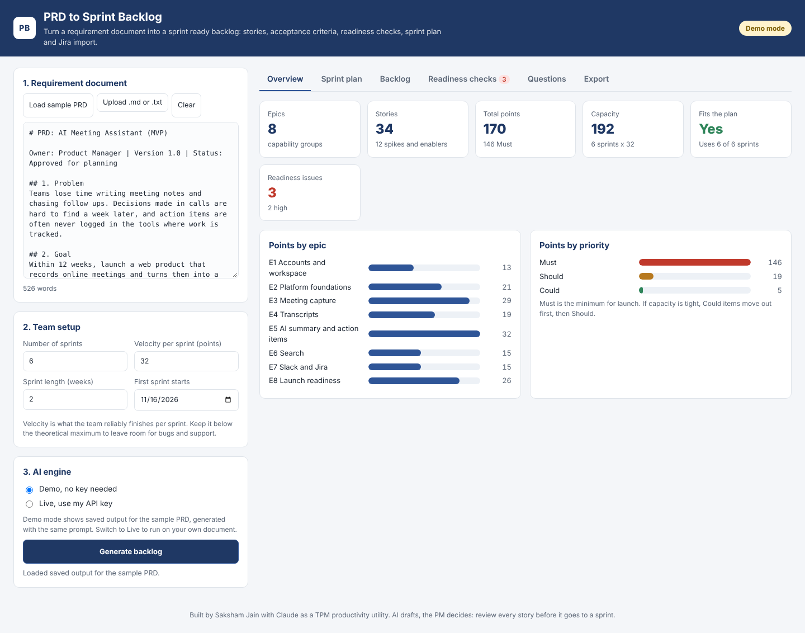
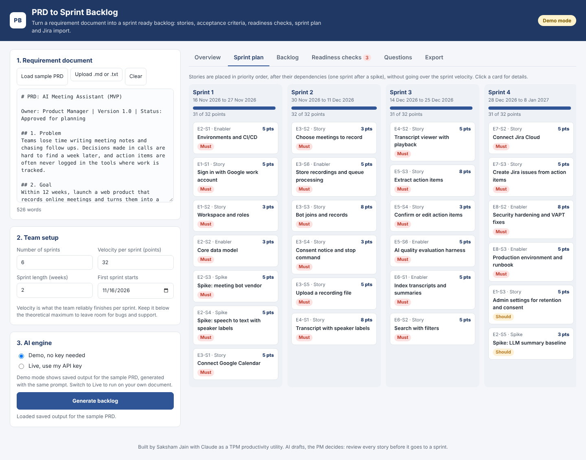
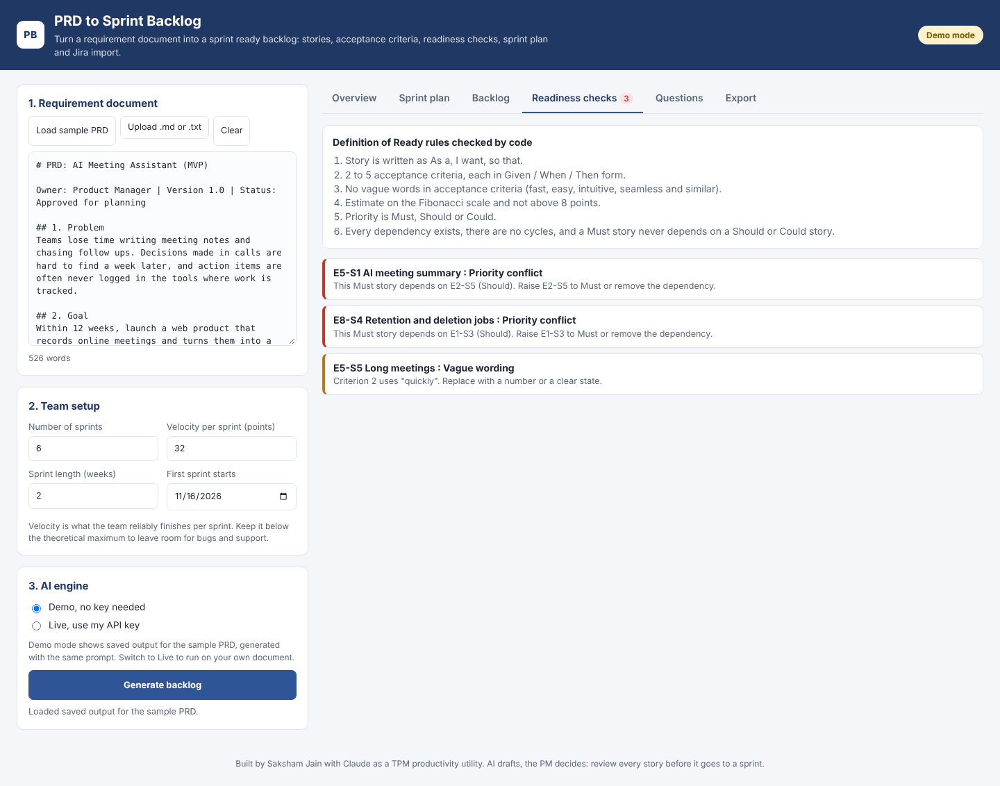
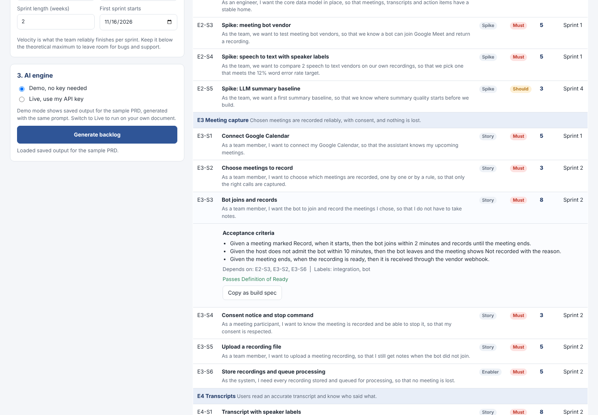

# PRD to Sprint Backlog

A small productivity utility for Technical Project Managers. Paste a product requirement document (PRD) or a client brief, and get a sprint ready backlog in under a minute:

1. Epics and user stories in the "As a, I want, so that" format
2. Testable acceptance criteria in Given / When / Then form
3. Fibonacci story points, MoSCoW priority, spikes, enablers and dependencies
4. A Definition of Ready check on every story
5. A sprint plan that respects dependencies and team velocity
6. Open questions to take back to the client
7. Export to a Jira import CSV, Markdown or JSON, or copy any story as a build spec for a developer or Claude Code

Built by Saksham Jain for the PanScience Innovations Technical Project Manager assignment (Part 11, Option A: Sprint Planning Assistant).

**Live app:** https://sakshamjaiin.github.io/pan_science_assignment/ (works in demo mode with no key)

## Why this tool
The slowest part of starting a project is turning business language into stories that developers can build from. A TPM spends hours writing stories, chasing missing acceptance criteria, estimating and laying out sprints, then retyping everything into Jira. This tool drafts all of that in one pass and checks the draft against the team's Definition of Ready, so the TPM spends their time on judgement: reviewing, asking the client the open questions, and making trade offs.

## Quick start (no install)
1. Open the live app, or download this repo and open `index.html` in Chrome, Edge or Firefox.
2. Click **Load sample PRD**. It is the PRD for the AI Meeting Assistant MVP from the assignment.
3. Click **Generate backlog**. Demo mode loads saved output, so no key is needed.
4. Walk through the tabs: Overview, Sprint plan, Backlog, Readiness checks, Questions, Export.
5. Change **Velocity per sprint** to 20 and watch the plan show what no longer fits.

No build step, no server and no dependencies. It is plain HTML, CSS and JavaScript.

## Live mode with your own document
1. Choose **Live, use my API key**.
2. Pick a provider and paste your key:
   1. Anthropic Claude: key from https://console.anthropic.com (default model `claude-sonnet-5-5`)
   2. Google Gemini: key from https://aistudio.google.com (default model `gemini-2.5-flash`)
3. Paste your PRD, or upload a `.md` or `.txt` file, then click **Generate backlog**.

The model name is editable, in case you want a different model. The key stays in the browser tab, is never saved, and is sent only to the provider you pick. Do not commit API keys to this repo.

## How it works

The AI only does what AI is good at: drafting language. Everything that must be exact is plain code, so the result is repeatable and easy to audit.

| Step | Done by | What happens |
|---|---|---|
| 1. Draft | LLM (Claude or Gemini) | Reads the PRD with the prompt in `prompts/backlog_prompt.md` and returns structured JSON: epics, stories, acceptance criteria, points, priority, dependencies, assumptions, open questions |
| 2. Check | Code (`assets/app.js`) | Runs Definition of Ready rules on every story |
| 3. Plan | Code | Fills sprints up to the velocity, all Must stories first, then Should, then Could, so lower priority work never pushes a Must story out. Each story's dependencies are placed before it, and a story that depends on a spike goes at least one sprint after it |
| 4. Export | Code | Jira CSV, Markdown, JSON, or a build spec per story |

### Definition of Ready rules
1. The story is written as "As a, I want, so that".
2. It has 2 to 5 acceptance criteria, each in Given / When / Then form.
3. No vague words in acceptance criteria (fast, easy, intuitive, seamless and similar).
4. The estimate is on the Fibonacci scale and not above 8 points.
5. Priority is Must, Should or Could.
6. Every dependency exists, there are no cycles, and a Must story never depends on a Should or Could story.
7. Every story has a unique id (missing ids are filled in and repeated ids are renamed, and both are reported).

In the sample, the checks catch two real planning problems: two Must stories depend on Should items, and one acceptance criterion says "quickly" instead of a number. This is the kind of review a TPM does by hand before sprint planning.

### Import into Jira
1. Download the CSV from the Export tab.
2. In Jira: Filters or Issues, then **Import issues from CSV** (Jira Cloud: Settings, System, External system import, CSV).
3. Map `Issue Id` and `Parent Id` so stories link to their epics, and map `Story Points` and `Sprint`.
4. The `Sprint` column only matches sprints that already exist on your board. Create Sprint 1 to N first, or leave the column unmapped.

### Copy as build spec
On the Backlog tab, open any story and click **Copy as build spec**. You get a self contained Markdown task with the user story, acceptance criteria, dependencies and Definition of Done, ready to hand to a developer or paste into Claude Code.

## Files
| Path | What it is |
|---|---|
| `index.html` | The app |
| `assets/app.js` | Readiness checks, sprint allocation, exports and the API calls |
| `assets/styles.css` | Styles |
| `assets/sample-prd.md` | The sample PRD (AI Meeting Assistant MVP) |
| `assets/demo-output.js` | Saved output for the sample PRD, used by demo mode |
| `prompts/backlog_prompt.md` | The exact system prompt sent to the model |
| `assets/sample-prd.js`, `assets/prompt.js` | Generated copies of the two files above, so the app also runs from `file://` |
| `build_assets.py` | Regenerates the two generated files after you edit the PRD or prompt |
| `docs/` | Screenshots |

## AI tools and workflow used
1. **Claude** to shape the idea, write the prompt, generate the sample output from the sample PRD, and build and test the app.
2. **Claude Code** to run the app locally, review it and push it to this repository.
3. I reviewed every story in the sample output and the checks, and I own the planning decisions. The tool follows the same rule: AI drafts, the PM decides.

## Limits and next steps
1. Demo mode only has saved output for the sample PRD. Any other document needs live mode.
2. The CSV follows Jira's standard CSV import. Field names can differ between Jira setups, so check the mapping screen.
3. Next steps: push stories straight to Jira through its API, compare two drafts of a PRD to show scope changes, and save velocity history to suggest a realistic velocity.
